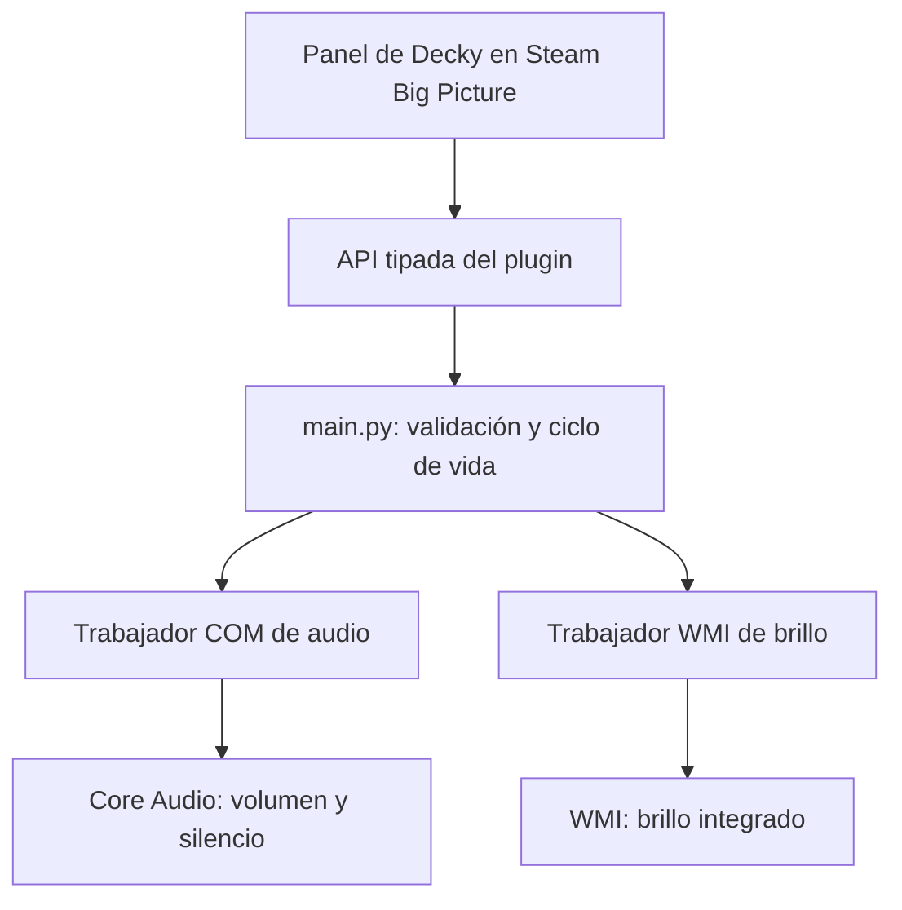

# Plan de Ally System Control

Fecha de referencia: 2 de noviembre de 2026, Europe/Madrid. Nombre provisional: **Ally System Control**. Identificador de carpeta previsto: `ally-system-control`.

Este documento conserva el plan de referencia. La implementación inicial ya está en marcha; el estado verificado y las comprobaciones pendientes están en [TESTING.md](TESTING.md).

## 1. Objetivo y primera entrega

Crear un plugin de Decky Loader para Windows 11, accesible desde Steam Big Picture y manejable con los controles de la Ally y la pantalla táctil.

La versión 0.1 incluirá:

| Control | Comportamiento |
| --- | --- |
| Volumen | Leer y ajustar el volumen maestro de la salida predeterminada, de 0 a 100 %. |
| Silencio | Activar y desactivar mute, conservando el nivel de volumen. |
| Brillo | Leer y ajustar la retroiluminación de la pantalla integrada según los niveles admitidos. |
| Estado | Mostrar porcentajes reales, disponibilidad y un mensaje breve ante errores. |
| Sincronización | Reflejar cambios hechos desde Windows, botones físicos o Armoury Crate. |

Se usará la instalación existente de Decky como punto de partida. La primera fase comprobará su versión y la carga de un plugin mínimo antes de desarrollar los controles.

El plugin depende de Steam/Decky: no será inicialmente un panel global sobre cualquier juego de Xbox, Game Pass o cualquier otro lanzador. Su disponibilidad durante un juego dependerá de que el menú de Decky sea accesible en esa sesión; habrá que verificarlo en la Ally.

## 2. Equipo realmente comprobado

Datos obtenidos mediante consultas locales de solo lectura. El detalle está en `environment-audit.json`.

| Elemento | Resultado |
| --- | --- |
| Modelo comunicado por Windows | `ROG XBOX Ally X RC74XA RC74XA`. Se conserva el identificador real, sin sustituirlo por el de una ficha comercial. |
| CPU | AMD Ryzen AI Z2 Extreme. |
| GPU | AMD Radeon 890M; controlador `32.0.32015.7029`. |
| Memoria física | 24 GiB. Windows comunica aproximadamente 13,62 GiB visibles; no se ha determinado la causa de la diferencia. |
| Sistema | Windows 11 Pro x64, compilación 26300. |
| BIOS | `RC74XA.303`. |
| Pantalla de brillo WMI | `SDC4501`, activa; 101 niveles, de 0 a 100; valor observado 100 %. |
| Otros monitores | También se detecta `AUS32F2`; no expone una segunda instancia de brillo WMI en esta auditoría. |
| Steam | Instalado; `steamwebhelper` escucha en `127.0.0.1:8080`. Esto no demuestra compatibilidad visual del plugin. |
| Decky | Carpeta `%USERPROFILE%\homebrew`, cinco carpetas de plugins y procesos activos; listener en `127.0.0.1:1337`. Versión y runtime instalado pendientes de identificar. |

Los seis procesos `PluginLoader_noconsole` observados tienen relaciones padre/hijo. Su número no demuestra que existan seis instalaciones ni justifica terminarlos.

El archivo `.cef-enable-remote-debugging` está presente en la carpeta de Steam y el puerto CEF está activo. No hace falta crear otro marcador ni cambiar esta configuración para la planificación.

**Comprobado:** lecturas WMI y presencia de la instancia de métodos de brillo. **Pendiente:** escritura efectiva, permisos desde el proceso de Decky, lectura/control Core Audio y funcionamiento de la interfaz en Big Picture.

## 3. Base tecnológica y compatibilidad

Decky upstream publica ejecutables Windows experimentales desde v3.3.0. La release estable más reciente comprobada es **v3.3.1**, del 27 de octubre de 2026, con binarios Windows x64. Es una referencia para comparar con la instalación actual, no una actualización ya realizada. [Releases oficiales](https://github.com/SteamDeckHomebrew/decky-loader/releases/tag/v3.3.1), [incorporación de Windows](https://github.com/SteamDeckHomebrew/decky-loader/releases/tag/v3.3.0).

| Capa | Elección | Motivo |
| --- | --- | --- |
| Interfaz | React + TypeScript, `@decky/ui`, `@decky/api`, Rollup | Componentes y comunicación propios de Decky. |
| Entrada del backend | `main.py`, API de plugin versión 1 | Integración directa con el backend Python del loader. |
| Integración Windows | Adaptadores Python con `comtypes` y biblioteca estándar | Acceso a COM/WMI sin compilar un helper ni instalar un SDK de ASUS. |
| Desarrollo frontend | Node.js 26 LTS + pnpm 9.15.9 | Node 26 está disponible como LTS; el template de plugins pide pnpm 9. |
| Desarrollo backend | Python 3.14 x64 en entorno virtual, cuando se prepare esta fase | Aproximar el runtime del binario oficial y aislar las dependencias. |
| Distribución inicial | ZIP local para Windows x64 | Permite probar y revertir sin depender de la aceptación de la tienda. |

La CI de Decky v3.3.1 empaqueta Python 3.14.8 con PyInstaller. El ejecutable incorpora su intérprete; instalar Python global no cambia el runtime del loader. El rango declarado para desarrollar el loader es `>=3.10,<3.15`. El Python 3.15.2 existente se conserva y sirve para tareas generales, pero no se considerará prueba de compatibilidad del backend dentro de Decky. El runtime de la instalación actual se medirá desde el plugin mínimo. [CI exacta](https://github.com/SteamDeckHomebrew/decky-loader/blob/v3.3.1/.github/workflows/build.yml), [rango Python](https://github.com/SteamDeckHomebrew/decky-loader/blob/v3.3.1/backend/pyproject.toml).

La plantilla oficial se tomará como referencia fijando el commit `90d0780e882a17f5714fc6de044c645f22608290`. Sus tareas usan herramientas Linux y su `package.json` incluye un binario Rollup Linux musl como dependencia directa: se adaptarán a PowerShell y a los binarios Windows. Se eliminarán los flags de ejemplo `debug` y `_root` de la configuración de distribución. [Plantilla](https://github.com/SteamDeckHomebrew/decky-plugin-template/tree/90d0780e882a17f5714fc6de044c645f22608290).

## 4. Arquitectura



El backend separará el contrato público de las APIs de Windows. Así podrán añadirse funciones futuras sin acoplar la interfaz a WMI, COM o al modelo concreto de Ally.

- Audio y brillo tendrán trabajadores separados: una llamada WMI lenta no ocupará la cola de audio. Cada trabajador mantendrá sus objetos COM en el mismo hilo, inicializado con `CoInitializeEx` y liberado con `CoUninitialize`. Las consultas no bloquearán el bucle async de Decky. [Reglas de COM por hilo](https://learn.microsoft.com/en-us/windows/win32/learnwin32/initializing-the-com-library).
- Las operaciones de cada control se serializarán y los movimientos rápidos se agruparán conservando el último valor solicitado. Un fallo de brillo no impedirá utilizar volumen.
- Las consultas WMI tendrán esperas limitadas donde la API lo permita y la espera pública tendrá timeout. Cancelar una espera async no interrumpe una llamada COM síncrona: si el proveedor queda bloqueado, se marcará brillo como no disponible para esa sesión, sin acumular hilos de reemplazo. Se recuperará mediante recarga del backend. Un timeout de escritura no se presentará como cancelación confirmada; antes de reintentar se leerá el estado efectivo.
- El MVP consultará el estado al abrir el panel y cada segundo mientras esté visible. Al cerrarlo se cancelará el sondeo. No se lanzará un proceso PowerShell por movimiento del slider.
- Después de escribir se releerá el valor efectivo. La UI distinguirá valor solicitado, confirmado y error, y descartará respuestas antiguas que lleguen fuera de orden.
- Al volver a abrir el panel tras suspensión, desconexión o reinicio se enumerarán de nuevo los dispositivos. No se mantendrán identificadores COM caducados.
- El plugin usará el canal de Decky; no añadirá un servidor HTTP ni puertos propios. Se diseñará para el usuario interactivo sin elevación habitual. Los permisos reales se verificarán en el loader existente.
- No se reaplicarán valores de volumen/brillo al iniciar o descargar el plugin. Windows mantendrá el estado y el usuario conservará el control desde sus herramientas habituales.

La limpieza cooperativa tendrá un plazo limitado y no esperará indefinidamente a un trabajador bloqueado. En Windows, el loader puede terminar directamente el proceso del backend y omitir `_unload`; se verificará ese ciclo real. Los hilos del plugin quedarán dentro de ese proceso y no se crearán helpers persistentes en el MVP. Si las pruebas de fase 2 muestran que hace falta un proceso auxiliar para aislar WMI, su vida deberá vincularse al backend mediante un Job Object de Windows, sin depender únicamente de `_unload`. [Ciclo de vida del backend](https://github.com/SteamDeckHomebrew/decky-loader/blob/v3.3.1/backend/decky_loader/plugin/plugin.py).

`comtypes` es una biblioteca COM escrita en Python. Se fijará una versión después de probar su importación en el runtime real de Decky y se incluirá en `py_modules` con su licencia. También se comprobará que la generación/caché de bindings funcione en el proceso empaquetado. Si requiere caché, irá al directorio de datos del plugin. [Proyecto comtypes](https://github.com/enthought/comtypes).

## 5. Volumen y silencio

El adaptador localizará la salida predeterminada de reproducción mediante `IMMDeviceEnumerator.GetDefaultAudioEndpoint(eRender, eConsole)` y activará `IAudioEndpointVolume`. Convertirá el porcentaje de la UI a la escala normalizada 0..1 y usará `Get/SetMasterVolumeLevelScalar` y `Get/SetMute`. No hará una conversión lineal improvisada a decibelios. [API oficial Core Audio](https://learn.microsoft.com/en-us/windows/win32/api/endpointvolume/nn-endpointvolume-iaudioendpointvolume).

El objetivo es el volumen maestro de Windows para esa salida, no el mezclador de cada juego ni el micrófono. Si cambia la salida predeterminada a auriculares, USB, Bluetooth o HDMI, se detectará en el refresco y también antes de cada escritura. Las peticiones pendientes llevarán el identificador/generación de la salida: al cambiarla se descartarán las antiguas y se consultará el nuevo estado. Si no hay salida, el control se deshabilitará con un estado explícito. [Salida predeterminada](https://learn.microsoft.com/en-us/windows/win32/api/mmdeviceapi/nf-mmdeviceapi-immdeviceenumerator-getdefaultaudioendpoint).

El slider no quitará silencio de forma implícita: mute tendrá su botón independiente. Se probará esta interacción con el comportamiento real del controlador. En audio exclusivo, el efecto depende de que el dispositivo ofrezca control de volumen por hardware; se documentará cualquier limitación observada. [Alcance de IAudioEndpointVolume](https://learn.microsoft.com/en-us/windows/win32/api/endpointvolume/nn-endpointvolume-iaudioendpointvolume).

En una iteración posterior se sustituirá el sondeo de audio por notificaciones `IAudioEndpointVolumeCallback` y `IMMNotificationClient`, conservando una consulta al abrir el panel. [Notificaciones de salida](https://learn.microsoft.com/en-us/windows/win32/api/mmdeviceapi/nf-mmdeviceapi-immnotificationclient-ondefaultdevicechanged).

## 6. Brillo de la pantalla integrada

El adaptador enumerará las instancias activas `root\wmi:WmiMonitorBrightness` y las emparejará por `InstanceName` con `WmiMonitorBrightnessMethods`. Leerá `CurrentBrightness` y `Level[]` para construir el rango real. En este equipo se observaron todos los enteros de 0 a 100. [Clase WMI](https://learn.microsoft.com/en-us/windows/win32/wmicoreprov/wmimonitorbrightness).

La escritura usará `WmiSetBrightness(Timeout=0, Brightness=valor_admitido)`, comprobará el retorno y releerá el resultado. En paneles con saltos discretos se elegirá el nivel admitido más cercano. Si hay varias instancias de brillo, se resolverá explícitamente cuál es la integrada antes de habilitar escritura. [Método WmiSetBrightness](https://learn.microsoft.com/en-us/windows/win32/wmicoreprov/wmisetbrightness-method-in-class-wmimonitorbrightnessmethods).

Se controla la retroiluminación, no gamma, filtros de color ni un oscurecimiento artificial de la imagen. Se comprobará la convivencia con los controles de Windows/ASUS y con ajustes automáticos del sistema. Si el panel está desconectado o el proveedor no responde, se mostrará «Brillo no disponible» sin recurrir a otro monitor.

Los monitores externos quedan para otra fase: normalmente necesitan DDC/CI y comprobaciones por monitor. La instancia `AUS32F2` detectada no se asumirá compatible. [Microsoft Monitor Configuration](https://learn.microsoft.com/en-us/windows/win32/monitor/monitor-configuration).

## 7. Contrato público y experiencia de uso

| Método previsto | Entrada | Salida o efecto |
| --- | --- | --- |
| `get_capabilities()` | Ninguna | Disponibilidad por control, niveles de brillo y versión del contrato. |
| `get_state()` | Ninguna | Volumen, mute, brillo, dispositivo actual y errores por control. |
| `set_volume(percent)` | Número finito 0..100 | Aplicar y devolver estado efectivo de audio. |
| `set_mute(muted)` | Booleano estricto | Cambiar silencio y devolver estado efectivo de audio. |
| `set_brightness(percent)` | Número finito 0..100 | Ajustar al nivel soportado y devolver brillo efectivo. |
| `set_panel_active(active)` | Booleano | Iniciar/detener actualización visible; no cambia ajustes del sistema. |

El backend rechazará valores fuera de rango, NaN, infinito y tipos incorrectos. Los errores distinguirán `unsupported`, `device_unavailable`, `access_denied`, `timeout` y `operation_failed`. Un porcentaje desconocido se devolverá como nulo, no como cero.

El panel tendrá dos sliders con porcentaje, un botón de silencio y el nombre de la salida de audio. Se usarán componentes Decky con foco y navegación de mando; ajustes de 1 punto y controles táctiles legibles a 1080p. La actualización visual será inmediata y la confirmación del sistema llegará después. Como punto inicial, se limitarán las escrituras a una cada 100–150 ms, con envío del último valor al terminar de mover el control; se ajustará tras medir en la Ally.

Los errores aparecerán junto al control, sin generar una notificación por cada movimiento. No se mostrarán detalles de COM, WMI o del runtime en el flujo normal. Los datos técnicos estarán en el diagnóstico.

## 8. Estructura prevista del repositorio

Esta es la estructura prevista en el plan; la implementación inicial emplea `worker.py` y `windows/apartment.py` para separar la cola y la inicialización COM.

```text
ally-system-control/
  plugin.json                  # Identidad, api_version 1 y metadatos
  package.json                 # Versiones de frontend y packageManager fijados
  pnpm-lock.yaml
  rollup.config.js
  main.py                      # Entrada de Decky y API pública
  py_modules/
    ally_system_control/
      __init__.py
      models.py
      controller.py            # Colas, sincronización y errores
      windows/
        __init__.py
        audio.py
        brightness.py
        com_worker.py
    comtypes/                  # Dependencia incluida con su licencia
  src/
    index.tsx
    api.ts
    components/
  tests/                       # Contrato, concurrencia y fallos relevantes
  scripts/
    diagnose-environment.ps1
    build.ps1
    deploy-dev.ps1
    package.ps1
  docs/
  LICENSE
```

Decky añade `py_modules` al path de importación; `main.py` será una entrada pequeña que importe `ally_system_control`. No se dependerá del directorio de trabajo del repositorio ni se supondrá que una carpeta hermana `backend` es importable automáticamente. [Importación del plugin](https://github.com/SteamDeckHomebrew/decky-loader/blob/v3.3.1/backend/decky_loader/plugin/sandboxed_plugin.py).

La distribución contendrá una carpeta `ally-system-control` con `plugin.json`, `package.json`, `main.py`, `dist/index.js`, `py_modules`, dependencias y licencias. No incluirá `.venv`, `node_modules`, caches ni el inventario del equipo. Se verificará el ZIP desde una extracción limpia dentro de Decky, además de las pruebas locales. [Formato ZIP de la plantilla](https://github.com/SteamDeckHomebrew/decky-plugin-template#distribution).

## 9. Fases y condiciones de salida

| Fase | Trabajo | Se termina cuando… |
| --- | --- | --- |
| 0. Auditoría | Inventariar hardware, herramientas, procesos y WMI sin cambiar valores. | Hecho. Quedan identificados los límites de la comprobación. |
| 1. Entorno y viabilidad Decky | Instalar Node/pnpm; resolver Git en la sesión; identificar versión, runtime y modo de arranque actuales. Adaptar una plantilla mínima y cargarla de forma reversible. | El panel aparece, una llamada Python devuelve datos, se puede descargar/recargar sin afectar otros plugins y se registra el runtime real. |
| 2. Backend de lectura | Probar comtypes dentro de Decky; leer salida de audio/mute y brillo, aislar errores y dispositivos ausentes. Preparar Python 3.14 de desarrollo si corresponde al runtime encontrado. Probar timeout WMI y terminación del backend. | Las lecturas coinciden con Windows; un fallo o bloqueo de brillo deja audio disponible; la recarga termina el proceso anterior sin dejar recursos activos. |
| 3. Control del sistema | Añadir setters de volumen, mute y brillo, validación y lectura posterior. | Los cambios efectivos coinciden con la petición dentro de la granularidad del dispositivo. |
| 4. Interfaz del MVP | Incorporar sliders, foco de mando, táctil, sincronización visible y agrupación de escrituras. | Se puede usar íntegramente con el mando y desde la pantalla táctil; los cambios externos se reflejan. |
| 5. Estabilidad y distribución 0.1 | Probar suspensión, recargas, errores y juego; crear scripts PowerShell y ZIP con dependencias fijadas y licencias. | Una instalación limpia funciona, la reversión está documentada y no quedan tareas activas tras descargar el plugin. |
| 6. Ampliaciones | Priorizar una función cada vez según uso real. | Cada ampliación tiene su comprobación de capacidad y sus pruebas antes de integrarse. |

Orden de dependencia: 1 → 2 → 3 → 4 → 5. Tras fijar el contrato, el trabajo visual con datos simulados y el backend podrán avanzar en paralelo. No se promete una fecha hasta superar la viabilidad del loader existente.

## 10. Validación y aceptación de la versión 0.1

| Escenario | Resultado exigido |
| --- | --- |
| Abrir y recargar | Leer los valores actuales; no alterarlos durante inicio, recarga o descarga. |
| Volumen y silencio | Probar niveles bajo/medio/alto y extremos controlados; mute no destruye el nivel guardado por Windows. |
| Brillo | Probar varios niveles admitidos, confirmar lectura posterior y comprobar visualmente el panel integrado. |
| Cambios externos | Botones físicos, panel de Windows y Armoury Crate se reflejan en aproximadamente 1–2 s con el panel abierto. |
| Mando y táctil | Navegación completa, foco visible y porcentajes legibles; no exige teclado. |
| Auriculares/USB/Bluetooth/HDMI | Seguir la salida predeterminada sin escribir en un endpoint desconectado. Probar los accesorios disponibles. |
| Monitor externo/dock | El control de brillo sigue dirigido al panel integrado; el externo no se modifica por accidente. |
| Suspender y reanudar | Reenumerar al reabrir, recuperar lecturas y no reaplicar valores anteriores. |
| Desconexión o acceso denegado | Deshabilitar solo el control afectado y permitir reintento. |
| Movimientos rápidos | Prevalece el último valor; la cola no crece indefinidamente y no aparecen saltos por respuestas antiguas. |
| Cerrar/descargar | Dejar de aceptar cambios, descartar peticiones aún no iniciadas y cancelar sondeos. Comprobar limpieza cooperativa y terminación forzada del backend sin asumir que `_unload` se ejecuta. |
| Uso en juego | Probar un juego accesible desde Steam y documentar disponibilidad del menú y limitaciones de audio exclusivo. |
| Paquete limpio | Instalar el ZIP sin depender del entorno virtual ni de Python global. |

Las pruebas automatizadas cubrirán reglas de entrada, adaptación de niveles, cambios de dispositivo, agrupación de peticiones y limpieza de recursos mediante adaptadores simulados. El resultado real de audio/brillo se comprobará en la Ally: un mock no demuestra soporte del hardware. Las escrituras de prueba guardarán el estado previo y lo restaurarán al terminar, incluidos fallos, sin sustituir cambios concurrentes realizados por el usuario.

Objetivos iniciales de consumo: sondeo solo con el panel visible; ninguna actividad periódica de controles al cerrarlo; comprobar que CPU y memoria vuelven al estado estable tras varias recargas. Las cifras finales se medirán, no se darán por garantizadas.

## 11. Despliegue, reversión y límites

El despliegue de desarrollo se hará únicamente en la carpeta del nuevo plugin dentro de `%USERPROFILE%\homebrew\plugins`. Si ya existe, se respaldará antes de reemplazarla. Se preferirá la recarga del plugin; cualquier reinicio necesario de Steam se coordinará con el uso del equipo.

Desinstalar consistirá en retirar el nuevo plugin y sus datos propios. No requerirá revertir ajustes de brillo/volumen: se conservará el último estado decidido por el usuario. La instalación actual de Decky y los cinco plugins existentes se mantendrán como referencia hasta verificar una razón concreta para cambiarlos.

| Incertidumbre | Cómo se resuelve |
| --- | --- |
| Versión/runtime del loader instalado | Medir desde el plugin mínimo; el nombre del EXE no basta. |
| Windows experimental | Ensayo de carga y ciclo de vida antes de invertir en la UI completa. Algunas funciones de plataforma del loader siguen sin implementar. [Código Windows](https://github.com/SteamDeckHomebrew/decky-loader/blob/v3.3.1/backend/decky_loader/localplatform/localplatformwin.py). |
| Importación COM en el EXE empaquetado | Probar comtypes y caché dentro de Decky, no solo desde una terminal. |
| Método WMI expuesto pero escritura fallida | Comprobar retorno, contexto y permisos; no asumir que necesita administrador. |
| Actualizaciones de Steam/Decky | Registrar la combinación probada y mantener rollback del plugin. |
| Publicación en la tienda | Verificar criterios y soporte de Windows antes de solicitar inclusión; distribución ZIP primero. |

Si el loader existente no supera la fase 1, se documentará el fallo concreto y se evaluará el ejecutable oficial x64 v3.3.1 mediante una migración reversible. Un cambio a otro sistema de plugins sería una decisión de alcance posterior, no una dependencia inicial.

## 12. Ruta de ampliación

Después de estabilizar la versión 0.1: selección explícita de salida de audio, eventos de volumen/brillo en lugar de sondeo, perfiles opcionales, batería/estado de carga y más adelante controles específicos de ASUS. TDP, ventiladores, límites térmicos, frecuencias y acceso al EC necesitarán una investigación propia sobre esta revisión de hardware y no se derivarán de las APIs del MVP.

Las herramientas e instrucciones de instalación están en [SETUP.md](SETUP.md). Las versiones indicadas son la fotografía de la investigación de hoy y se volverán a comprobar al preparar el entorno.
